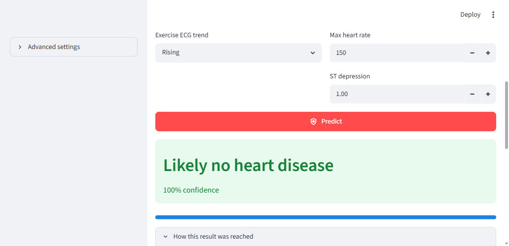

# Heart Disease Prediction (KNN)

A Streamlit web app that predicts the presence of heart disease using a
**K-Nearest Neighbours** classifier trained on the Heart Disease dataset
(918 patients, 11 raw features).

## What it does

Enter a patient's details, press **Predict**, and the app returns a
diagnosis with a confidence score, plus an explanation of which training
patients drove the result.

| File | Purpose |
|---|---|
| `app.py` | The Streamlit application |
| `train.py` | Reproducible training script |
| `heart.csv` | Source dataset (918 patients) |
| `knn_heart_model.pkl` | Fitted `KNeighborsClassifier` |
| `scaler.pkl` | Fitted `StandardScaler` |
| `heart_columns.pkl` | Expected feature column order |
| `training_report.json` | Metrics and settings from the last training run |

## Model performance

The bundled model is trained by `train.py` and scores **86.4%** on a held-out
test split (184 patients never seen during training):

```
              precision    recall  f1-score   support
           0       0.83      0.88      0.85        82
           1       0.90      0.85      0.87       102
    accuracy                           0.86       184
```

`k=7` was chosen by 5-fold cross-validation on the training split rather than
assumed. Median confidence across the dataset is 71%.

## Screenshot



## Running it

```bash
pip install -r requirements.txt
streamlit run app.py
```

The app opens at <http://localhost:8501>.

## Retraining

```bash
python train.py                # writes *_fixed.pkl alongside the originals
python train.py --compare      # also explain the original artifacts' bug
python train.py --promote      # overwrite the artifacts the app loads
```

`--promote` is what produced the artifacts currently in the repo, so the
committed model is reproducible from `heart.csv` alone.

## How the model works

KNN makes no arithmetic prediction of its own. For a new patient it measures
the distance to every training patient in standardised space, takes the `k`
closest, and returns their majority diagnosis. The app shows this directly —
"3 of the 5 closest patients share this result" — so a prediction is always
traceable back to real patients rather than an opaque score.

### Feature encoding

The 11 raw features expand to 15 model inputs via one-hot encoding:

- `Sex` → `Sex_M`
- `ChestPainType` → `ChestPainType_ATA`, `_NAP`, `_TA`
- `RestingECG` → `RestingECG_Normal`, `_ST`
- `ExerciseAngina` → `ExerciseAngina_Y`
- `ST_Slope` → `ST_Slope_Flat`, `_Up`

Encoding was created with `drop_first=True`, so two categories are absent and
must be represented by an all-zero row:

- **LV hypertrophy** — `RestingECG_Normal=0` *and* `RestingECG_ST=0`
- **Falling ST slope** — `ST_Slope_Flat=0` *and* `ST_Slope_Up=0`

The app encodes these deliberately. It also validates every dropdown against
its column mapping at runtime and blocks the prediction on mismatch, because a
mismatched flag would otherwise change the result silently.

### Input ranges

The numeric bounds in the UI match the source dataset. Note that `Oldpeak` may
be **negative** — a real finding meaning ST elevation rather than depression —
and the input allows it:

| Field | Dataset range | Accepted in app |
|---|---|---|
| `Age` | 28 – 77 | 1 – 120 |
| `RestingBP` | 0 – 200 | 1 – 300 |
| `Cholesterol` | 0 – 603 | 1 – 610 |
| `MaxHR` | 60 – 202 | 0 – 250 |
| `Oldpeak` | **-2.6** – 6.2 | -3.0 – 7.0 |

`RestingBP` and `Cholesterol` start at 1 rather than 0 because training replaced
zero readings with the column mean, so the model has never seen a literal `0`
for either field. Entering one would land far off-manifold. If a reading is
genuinely unknown, leave the default.

## What was wrong with the original model

The artifacts this repo first shipped contained a data-leakage bug. The
evidence, read directly from them:

- `scaler.n_samples_seen_` = **184**
- `model.n_samples_fit_` = **734**
- 184 + 734 = 918 = the full dataset

The scaler was fitted on the **test** split while the model was fitted on the
**train** split, so no honest accuracy figure existed for that pipeline.

Compounding it, `scaler.scale_[Age]` was `1.109` while raw `Age` has a standard
deviation of `9.43`. The scaler had never seen raw values, so applying it to a
raw patient produced absurd distances — a raw `Age` of 50 mapped to z ≈ 45,
putting the nearest training patient roughly 237 units away.

The original training code was never saved, so those artifacts could not be
regenerated or audited. That is what `train.py` now fixes.

## What `train.py` corrects

1. **Scaler fitted on the train split only.** The single change that makes the
   reported accuracy trustworthy.
2. **Only the five numeric columns are standardised.** The original scaled every
   binary dummy too. For KNN this matters more than usual, because Euclidean
   distance decides which patients count as neighbours — scaling dummies
   silently reweights the features. They now stay as 0/1.
3. **Median imputation instead of mean.** `Cholesterol == 0` (172 rows, 18.7%)
   means "not recorded". Substituting the mean of `244.64` conflated "not
   measured" with "genuinely 244"; the median is used instead.
4. **Stratified split and a fixed `random_state`.** The original split seed was
   unknown, so the original model cannot be reproduced exactly even in principle.

Run `python train.py --compare` to print this analysis against the old artifacts.

## Data

Source: [UCI Heart Disease dataset](https://archive.ics.uci.edu/dataset/45/heart+disease),
as commonly redistributed on Kaggle. Features are anonymised patient records;
this is for education and demonstration, **not for medical use**.